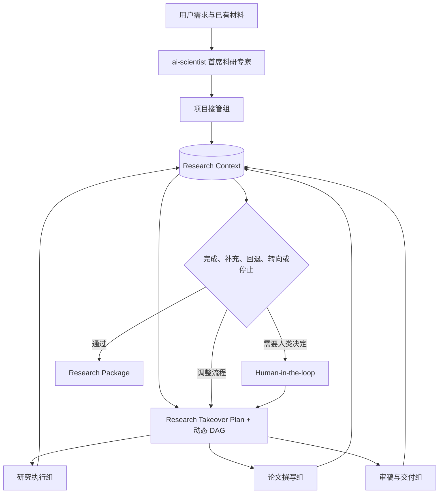

# AI Scientist OpenCode 科研专家团设计

> 版本：V1.0 设计基线  
> 日期：2026-08-05  
> 项目位置：`/Users/airwhistle/Documents/Codes/AI scientist`  
> 运行方式：用户直接使用 OpenCode 打开项目，通过 `@ai-scientist` 发起科研任务

## 1. 文档目标

本文定义 AI Scientist 的完整产品架构、科研专家团队、动态编排方式、Research Context、Human-in-the-loop、工具能力、实验条件分流、产物协议和验收标准。它是后续编写 OpenCode Agent Markdown、Skills、Tools、验证脚本与示例任务的唯一设计基线。

AI Scientist 不建设独立 Web 后端、数据库、通用科研 SaaS 或第二套 Agent Runtime。它与 `deepinsight-oc` 采用同一种产品构建方式：一个面向用户的首席科研专家通过 OpenCode `Task` 组建并调用由 Markdown 定义的专业科研专家，各专家通过文件化 workspace 协作，OpenCode 负责模型、工具、终端、权限、会话和子智能体运行。

AutoResearchClaw 是科研动作、工具能力、质量门、回退规则和产物协议的参考实现，不作为 AI Scientist 的运行依赖。它的 23 个固定阶段不会被整体嵌入，也不会再产生一套与 OpenCode 竞争的状态机。

## 2. 核心产品定义

AI Scientist 是一个运行在 OpenCode 中的科研专家团队。用户可以携带一个 Idea、一批论文、一篇目标论文、代码仓库、数据、半成品实验、运行日志、实验结果、论文草稿或审稿意见，从当前状态进入。首席科研专家先重建当前科研项目，再按需选择专家，生成本次任务专属流程，并根据执行结果持续调整。

系统的核心循环是：

```text
Gather：读取用户目标、已有资产、历史产物和当前约束
Act：调用本轮所需的科研专家和工具
Verify：验证输入输出契约、证据、实验真实性和完成条件
Adjust：继续、补充、修复、回退、转向、暂停或停止
```

因此，七类典型需求只是入口，不是七条写死的流水线；专家总数也不是预先锁死的产品指标。完整专家团预计由二三十位左右的科研专家构成，当前设计先给出 20 个稳定的核心角色，实施时可以根据职责边界、输入输出契约和真实运行效果继续拆分或合并。一个普通 Literature Review 可能调用 10～13 位专家，一个简单论文解读可能调用 5～8 位专家，一个完整 Idea 到论文任务才会动用大部分专家。

## 3. 架构原则

### 3.1 OpenCode 是唯一运行时

- OpenCode 发现和加载 `.opencode/agents/*.md`。
- `ai-scientist` 是唯一面向用户、唯一拥有科研团队调度权的 Agent。
- 专业科研专家均像 DeepInsight OC 的 `di-*` Agent 一样，由独立 Markdown 文件定义，使用 `mode: subagent` 接受首席专家的 Task 调用。
- 本设计不建立“公开专家”和“隐藏专家”两套角色等级。OpenCode 的 `hidden` 只是一项是否出现在 `@` 自动补全中的界面配置，不改变专家身份、职责和运行能力；实现时以“用户默认从首席专家进入、首席专家能够稳定组队”为准进行配置。
- 普通专家一律 `task: deny`，不允许私自组建子团队。
- 首席专家的 `permission.task` 先拒绝全部，再只允许 `as-*`。
- 首席专家原则上不直接进行专业研究；它负责规划、调度、验证、落盘、路由、人工确认和交付。
- 工具权限按岗位最小化：文献专家可以联网但不能改实验代码；实验执行专家可以读写和运行命令但不负责对外发布结论；独立审稿专家只能读取，不能修改被审查产物。

### 3.2 一个专家对应一个稳定的专业责任

专家的划分标准不是 AutoResearchClaw 的步骤编号，而是是否具有独立的专业目标、判断标准、输入输出契约和权限边界。过细会增加 Task 开销和上下文切换，过粗则会形成难以验证的超级 Agent。

本设计先把原先过度细分的原子职责归拢为 20 个核心角色，作为可运行架子的第一版专家清单，而不是把 20 当作不可改变的准确数量。每位专家可以在内部完成 2～4 个高度相关的科研动作，但不能跨越研究、执行和独立验证的责任边界。后续只有在真实运行证明某个角色过重、某项判断需要独立权限或某条路线缺少专业责任时才拆分；反之，长期总是共同出现且输入输出无法独立验收的角色可以合并。

### 3.3 结构化产物高于聊天记忆

所有长期有效状态写入 Research Context。专家之间主要传文件路径、对象标识和本次约束，不复制全部历史对话。每个 Task 完成后，首席专家必须先验证输出，再写入稳定文件；不能只依赖子会话中的最终消息。

### 3.4 计划是动态 DAG，不是一次性清单

首席专家生成 `Research Takeover Plan`，其中每个任务节点绑定一个专家、输入产物、输出产物、依赖、完成条件、人工闸门和失败回退目标。无依赖节点可以并行，有依赖节点按拓扑顺序执行。每个关键节点完成后，首席专家根据新证据更新 DAG。

### 3.5 失败、不可执行和否定结果都是正式科研状态

系统必须能够交付“不可执行”“资源不足”“未能复现”“假设被否定”“证据不足”或“需要外部实验条件”的诚实结论。不得为了完成流程制造引用、实验数据、运行日志或成功状态。

## 4. 总体运行结构



四个专家组分别回答：

1. 项目接管组：用户现在要做什么、已经有什么、从哪里接手、能不能做；
2. 研究执行组：如何获得证据、形成方法、准备和运行实验、分析结果；
3. 论文撰写组：如何把可信研究证据组织成论文、综述或技术报告；
4. 审稿与交付组：如何独立质疑、核验证据、修订并形成可复用研究包。

## 5. 首席科研专家

### `ai-scientist`

首席科研专家是项目负责人和动态编排者，不是一个包办所有工作的超级科研 Agent。

它负责：

- 保存用户原始输入，创建独立 run workspace；
- 判断是否需要先澄清目标、范围、当前状态或交付物；
- 调用项目接管组形成 Research Charter、资产清单和能力评估；
- 生成并维护 `Research Takeover Plan`；
- 从当前注册的科研专家库中组建本次团队；
- 按依赖关系执行 Task，能并行时并行；
- 校验专家输出并立即落盘；
- 维护 Research Context、Artifact Registry 和 Decision Log；
- 管理 Human-in-the-loop 与风险命令批准；
- 根据结果执行 PROCEED、REFINE、PIVOT、STOP；
- 组合最终 Research Package，并明确已验证、部分支持、未能验证和推测内容。

它不负责：

- 绕过专业专家直接编造文献结论；
- 在没有实验记录时声称已经运行；
- 未经确认扩大研究范围或预算；
- 代替人类决定成果公开、投稿或涉及伦理责任的事项。

## 6. 四组核心专业专家

下面 20 个角色是当前完整架子的核心清单，用于确保文献、方法、实验、写作和可信交付能够端到端跑通。它们不是最终数量上限。后续可以在四个专家组内部增加领域专家、专项实验专家或独立验证专家，但新增角色仍必须遵守同一套 OpenCode Agent Markdown、Task 调用、权限与产物协议。

### 6.1 项目接管组：4 位

#### 1. `as-intent-router`｜科研需求与状态识别专家

识别用户的主要意图、次要意图、当前科研阶段和预期交付物。支持 Idea、Survey、Literature Review、Paper Reading、Reproduction、Experiment、AI Coding、Writing、Revision、Review 和 Quality Check 等状态，也允许混合状态。输出 `02-intent-state.json`，不直接生成完整研究流程。

#### 2. `as-asset-auditor`｜科研资产与证据盘点专家

盘点论文、PDF、链接、代码仓库、提交、数据、模型、环境、实验计划、日志、指标、图表、草稿和审稿意见。标记版本、来源、许可证、读取状态、可信度和缺失项，输出 `03-asset-registry.json`。它只陈述实际发现，不根据常识补齐资产。

#### 3. `as-research-planner`｜研究章程与动态组队专家

把用户目标、当前状态和资产清单转化为 Research Charter 与 Research Takeover Plan。负责选择专家、安排依赖、可并行节点、必经模块、可跳过模块、人工闸门、预算和停止条件。首席专家拥有最终路由权，本专家提供结构化规划建议。

#### 4. `as-feasibility-advisor`｜可行性、资源与实验形态专家

评估研究所需的代码、数据、CPU/GPU、时间、费用、许可证、实验室、仪器、安全和伦理条件。把执行形态分类为 `computational`、`simulation`、`dry_lab`、`wet_lab`、`instrumental` 或 `hybrid`，输出当前可执行、需用户提供、可替代和不可伪造的边界。

### 6.2 研究执行组：10 位

#### 5. `as-literature-strategist`｜文献检索策略专家

负责研究问题拆分、数据库选择、关键词和布尔检索式、种子论文扩展、时间范围、纳入排除标准与查询预算。参考 AutoResearchClaw 的 Search Strategy，但为任意入口服务。输出 `10-search-plan.yaml`。

#### 6. `as-literature-researcher`｜多源论文发现与筛选专家

通过学术检索工具从 OpenAlex、Semantic Scholar 和 arXiv 等来源召回真实论文，完成去重、版本归并、相关性与质量筛选，并保留纳入排除理由和搜索日志。输出候选论文、短名单和来源元数据。

#### 7. `as-paper-evidence-analyst`｜论文深读与证据声明专家

解析论文问题、贡献、方法、公式、实验、数据、指标、图表、结论、局限和引用位置。把“作者声明”绑定到原文位置，不把作者声明升级为系统已验证事实。输出 Paper Analysis 与 Evidence Claims。

#### 8. `as-research-synthesizer`｜研究综合、Gap 与新颖性专家

基于筛选论文和证据卡构建方法谱系、技术路线、争议、结果差异和适用边界；识别 Gap、重复研究风险和可验证的候选机会。Literature Review 可以在此后进入写作，非 Idea 任务不强制生成新假设。

#### 9. `as-methodology-designer`｜研究问题、假设与 Methodology 专家

把模糊 Idea 形式化为研究问题，形成可证伪假设，选择定量、定性、计算、仿真、Dry Lab、实验室或混合研究方法。负责说明为什么选用该方法、何种结果会否定假设，以及方法在当前条件下能支持多强的结论。

#### 10. `as-experiment-designer`｜实验设计与统计方案专家

定义基线、对照、自变量、因变量、控制变量、数据划分、指标、随机种子、重复次数、统计检验、消融、敏感性分析、成功标准和停止条件。实验方案必须在运行前锁定，修改需要留下 Decision Log。

#### 11. `as-code-data-engineer`｜代码、数据与环境专家

审计官方代码和第三方实现，检查提交、许可证、依赖、数据来源和环境；完成必要的 AI Coding、配置、数据加载、评测脚本、测试和环境锁定。该专家可以修改实验 workspace，但不能决定最终科研结论。

#### 12. `as-experiment-operator`｜实验执行与运行监控专家

只在资源、权限和实验方案通过后执行计算或仿真实验，保存命令、代码版本、环境、配置、随机种子、日志、指标、资源和退出状态。湿实验或仪器实验不由 OpenCode 伪执行；此时只生成外部执行协议和数据回传模板。

#### 13. `as-experiment-diagnostician`｜失败诊断、Debug 与 Refine 专家

区分代码、依赖、数据、资源、运行、方法、实验设计和假设问题。提出有限次数的修复、缩比、补充实验、消融或转向方案。不得通过改变指标、数据划分或删除失败运行制造成功。

#### 14. `as-result-analyst`｜统计、图表与研究决策专家

检查数据完整性和异常，完成统计分析、图表、与原论文或预设成功标准的对齐，标明结论强度和局限，输出 `PROCEED`、`REFINE`、`PIVOT` 或 `STOP` 建议。失败但可解释的结果是合法成果。

### 6.3 论文撰写组：3 位

#### 15. `as-outline-architect`｜论文与综述结构专家

根据交付类型设计章节问题、论证顺序、证据分配、图表和引用需求。支持 Systematic Review、Narrative Review、复现报告、实验报告、技术报告和研究论文。大纲必须标记证据缺口，不能用写作掩盖研究不足。

#### 16. `as-evidence-writer`｜证据约束科研写作专家

只基于 Research Context 中允许使用的 Evidence Claim、Finding、Experiment Run 和 Human Decision 写作。区分原文声明、外部支持、实验支持、部分支持、未能复现、推测和人工确认。

#### 17. `as-figure-citation-editor`｜图表、引用与学术表达专家

组织图表、公式、源数据、References 和术语，检查图表与运行记录的绑定关系，完成结构和语言润色。它不能新增没有来源的数字或替换研究结论。

### 6.4 审稿与可信交付组：3 位

#### 18. `as-independent-reviewer`｜独立同行评审专家

从尽量独立的上下文审查研究问题、方法、实验、公平性、统计、结论和局限。优先读取原始证据与结构化产物，不直接继承执行团队的结论。输出阻断问题、主要问题、次要问题和修订建议。

#### 19. `as-quality-citation-auditor`｜质量、引用与可复现性审计专家

核对关键声明与证据、实验数字与真实运行、引用存在性与相关性、代码数据环境完整性、论文与研究包一致性。参考 AutoResearchClaw 的多层引用验证：arXiv 标识、CrossRef/DataCite DOI、Semantic Scholar 标题匹配和语义相关性检查。

#### 20. `as-research-package-curator`｜修订、归档与研究包专家

根据审稿与审计意见组织定向修订，生成最终交付清单、版本索引和 Research Package。它必须保留失败记录、人工决策、未解决限制和各产物的来源关系，不把聊天记录当作最终研究资产。

## 7. Skills、Tools 与外部能力

### 7.1 首期 Skills

Skills 只承载跨多个专家复用的方法规范，不把每个专家重复写成 Skill：

1. `literature-review`：检索策略、纳入排除、PRISMA 风格记录和证据综合；
2. `paper-analysis`：论文结构、方法、公式、实验声明和证据定位；
3. `experimental-methodology`：假设、变量、对照、统计、消融和停止规则；
4. `scientific-writing`：证据约束写作、章节结构、图表和学术表达；
5. `research-integrity`：引用、实验真实性、许可证、伦理和结论强度。

完整方法在首次调用时按需加载，避免所有专家同时携带全部科研规范。

### 7.2 OpenCode 内置能力

- `Task`：首席专家调用专业专家；
- `read`：读取论文文本、代码、数据说明、日志和 Research Context；
- `write/edit`：写入结构化产物或修改实验代码；
- `bash`：环境检查、测试、实验、统计和确定性验证；
- `question`：人工闸门；
- `websearch/webfetch`：补充公开资料和网页内容。

### 7.3 首期自定义 Tools

1. `academic-search`：按 OpenAlex → Semantic Scholar → arXiv 顺序检索，支持失败降级、去重和版本归并；
2. `citation-verify`：核验 arXiv、DOI、CrossRef/DataCite、Semantic Scholar 元数据；
3. `hardware-profile`：检查 CPU、GPU/MPS、内存、磁盘和可用执行条件；
4. `artifact-validate`：验证 JSON/YAML Schema、必需文件、引用关系和产物完整性。

这些工具会做成薄而确定的能力，不复制 AutoResearchClaw 的完整 Python 系统。首期不要求 MCP；只有未来存在稳定的科研数据库、集群、对象存储或内部平台接口时才接入 MCP。

## 8. Research Context 与 workspace

每次任务创建：

```text
tmp/ai-scientist-workspace/<run-id>/
├── 00-input.json
├── 01-research-project.json
├── 02-intent-state.json
├── 03-asset-registry.json
├── 04-research-charter.yaml
├── 05-takeover-plan.yaml
├── 06-capability-profile.json
├── 07-human-decisions.json
├── literature/
├── papers/
├── evidence/
├── methodology/
├── code/
├── experiments/
├── findings/
├── writing/
├── reviews/
├── deliverables/
├── artifact-registry.json
└── run-summary.json
```

Research Context 至少维护以下对象：

- `ResearchProject`：项目身份、生命周期和当前状态；
- `ResearchCharter`：目标、范围、约束、预算和停止条件；
- `ResearchTakeoverPlan`：专家团队、DAG、闸门和回退；
- `AssetRecord`：论文、代码、数据、环境、日志、草稿和意见；
- `PaperRecord`：论文版本、来源、标识和解读状态；
- `EvidenceClaim`：声明、证据位置、证据等级和允许表达强度；
- `ExperimentPlan`：假设、变量、对照、指标、资源和成功标准；
- `ExperimentRun`：代码、环境、配置、日志、指标、费用和状态；
- `Finding`：研究发现、支持程度、反例、局限和来源；
- `HumanDecision`：人工批准、修改、否决、暂停和发布决定；
- `ResearchArtifact`：报告、图表、代码包、数据说明和研究包；
- `ProvenanceLink`：产物之间的生成与引用关系。

## 9. Human-in-the-loop

### 9.1 默认必须确认

1. G1 研究范围：研究问题、综述范围、复现目标和交付物；
2. G2 资源与权限：数据许可、未知代码、高风险命令、GPU、费用和外部资源；
3. G3 实验方案：假设、基线、数据划分、指标、统计和成功标准；
4. G4 结论发布：关键结论、局限、引用、论文和公开范围。

### 9.2 动态升级为必须确认

- 系统无法判断用户当前状态或资产版本；
- 需要把真实实验替换为仿真、Dry Lab、合成数据或缩比实验；
- 需要显著增加预算、时间、资源或研究范围；
- 需要从 REFINE 转向 PIVOT；
- 关键证据缺失、引用核验失败或结果与原声明冲突；
- 涉及人体、临床、敏感数据、湿实验、危险材料或大型仪器；
- 连续修订仍未通过独立审查。

用户可以在任何阶段暂停、注入材料、修改约束、锁定产物或停止任务。所有决定写入 `07-human-decisions.json`。

## 10. 实验条件与能力分流

| 条件 | 系统行为 | 允许的结论 |
|-|-|-|
| 计算资源充分 | 按批准方案真实运行并记录全部证据 | 可形成实验支持结论 |
| 缺少 GPU 或资源不足 | 给出云资源、缩比、CPU、低精度或延迟方案并确认 | 替代实验只能支持对应规模的结论 |
| 存在可靠仿真环境 | 执行仿真并明确模型和参数 | 只能称为仿真证据 |
| 生物、化学湿实验 | 设计实验协议、样本、测量和统计，等待外部执行 | 没有真实数据时不能声称完成实验 |
| 需要仪器或大型装置 | 列出设备、场地、人员、安全和数据回传要求 | 条件未满足时停在设计或准备状态 |
| 数据受限或不可得 | 请求权限或提出公开/合成替代方案 | 必须降低结论强度并记录替代影响 |
| 人体或临床研究 | 要求伦理、隐私和合规条件 | 未批准前只允许方法设计和公开数据分析 |

## 11. 动态组队示例

### 11.1 Literature Review

默认团队：`as-intent-router`、`as-asset-auditor`、`as-research-planner`、`as-literature-strategist`、`as-literature-researcher`、`as-paper-evidence-analyst`、`as-research-synthesizer`、`as-outline-architect`、`as-evidence-writer`、`as-figure-citation-editor`、`as-independent-reviewer`、`as-quality-citation-auditor`、`as-research-package-curator`。

默认跳过实验设计、代码实现和实验运行，但保留论文写作、引用审计和独立评审。

### 11.2 论文复现

除 Literature Review 的证据专家外，加入 `as-feasibility-advisor`、`as-methodology-designer`、`as-experiment-designer`、`as-code-data-engineer`、`as-experiment-operator`、`as-experiment-diagnostician` 和 `as-result-analyst`。根据目标可以只复现某张表、某项指标或核心趋势。

### 11.3 Idea 到论文

使用大部分专家：先完成相关工作、Gap、问题与假设，再通过 G3 锁定实验方案，执行有限实验循环，最后写作和独立审查。假设被否定时可以 STOP 或在用户确认后 PIVOT，不能把否定结果改写成成功。

### 11.4 已有结果的论文写作

先由资产审计、结果分析和质量审计判断已有结果是否可信，再进入结构、写作、图表和审稿。证据不足时定向回退到文献、代码、实验或统计，而不是从头运行全部流程。

### 11.5 审稿意见修订

从资产审计、独立审稿和研究规划开始，把意见分为表达、引用、方法、实验和结论问题。表达问题直接修订；引用问题回到证据；方法问题回到 Methodology；实验问题回到实验设计或执行。

## 12. 项目目录设计

```text
AI scientist/
├── opencode.json
├── AGENTS.md
├── README.md
├── .gitignore
├── .opencode/
│   ├── agents/
│   │   ├── ai-scientist.md
│   │   └── as-*.md
│   ├── skills/
│   │   └── <五项科研方法 Skill>/SKILL.md
│   ├── tools/
│   │   ├── academic-search.ts
│   │   ├── citation-verify.ts
│   │   ├── hardware-profile.ts
│   │   └── artifact-validate.ts
│   └── package.json
├── contracts/
│   ├── research-project.schema.json
│   ├── takeover-plan.schema.json
│   ├── evidence-claim.schema.json
│   ├── experiment-plan.schema.json
│   ├── experiment-run.schema.json
│   └── research-package.schema.json
├── templates/
├── examples/
├── tests/
├── scripts/
│   └── validate-ai-scientist.sh
├── docs/
└── tmp/
```

### 12.1 与 DeepInsight OC 保持同构

AI Scientist 的可运行架子直接复用 `deepinsight-oc` 已验证的组织方式，不增加额外启动器：

| DeepInsight OC | AI Scientist | 作用 |
|-|-|-|
| `.opencode/agents/deepinsight.md` | `.opencode/agents/ai-scientist.md` | 面向用户的总编排 Agent |
| `.opencode/agents/di-*.md` | `.opencode/agents/as-*.md` | 由 Task 调用的专业专家 |
| `opencode.json` | `opencode.json` | 声明项目级 OpenCode 配置与所需 subagent depth |
| `tmp/research-workspace/<run-id>/` | `tmp/ai-scientist-workspace/<run-id>/` | 文件化运行状态、证据和产物 |
| Agent frontmatter permission | Agent frontmatter permission | 限定 Task、读写、终端、联网和人工交互边界 |
| `scripts/validate-zyzx.sh` | `scripts/validate-ai-scientist.sh` | 静态检查 Agent、权限、契约和关键路由 |

每个专家文件都采用 OpenCode 可直接发现的结构：

```markdown
---
description: <何时由首席科研专家调用，以及该专家解决什么问题>
mode: subagent
temperature: <与岗位稳定性匹配的数值>
permission:
  edit: deny
  bash: deny
  task: deny
  websearch: deny
  webfetch: deny
  read: allow
---

你是 AI Scientist 科研专家团中的 <专家名称>。

## 唯一职责
## 明确不负责
## 必须读取的 Research Context
## 工作方法与科研边界
## 输出契约
## 完成前自检
```

不同专家只调整真实需要的权限。例如文献研究专家允许学术搜索工具，代码与实验专家允许在本次实验 workspace 中编辑和运行，独立审稿专家保持只读。首席科研专家拥有 `task`、`question`、`read` 和 `write/edit`，但只允许调用 `as-*`，不直接绕过专家承担专业工作。

项目不要求用户安装或启动另一套服务。完成依赖安装和配置后，在项目根目录打开 OpenCode 即可加载 `opencode.json`、`AGENTS.md`、Agent、Skills 和 Tools。实施验收会同时运行：

```text
opencode debug config
opencode debug agent ai-scientist
opencode debug agent <抽样 as-* 专家>
bash scripts/validate-ai-scientist.sh
```

这些检查通过后，再使用公开样例从 `@ai-scientist` 发起一次端到端任务，确认 Task 调度、workspace 落盘、人工闸门、回退和 Research Package 都在真实 OpenCode Session 中工作。

项目启动后，用户只需要在该目录打开 OpenCode，然后输入：

```text
@ai-scientist <当前科研需求，并提供论文、代码、数据或其他材料>
```

## 13. 完整流程验收

“架子跑通”不等于每一种科研实验都自动成功，而是以下能力在 OpenCode 内完整闭环：

1. OpenCode 能发现 `ai-scientist` 和全部 `as-*` 专家；
2. 用户可以从任意已有状态进入；
3. 首席专家能生成资产清单、研究章程和动态组队计划；
4. 计划只选择需要的专家，并跳过无关能力；
5. 每位专家都能读取规定输入、产生符合契约的输出；
6. Research Context 随流程持续更新；
7. Human-in-the-loop 在必须节点真实阻塞；
8. 计算实验可以在权限范围内运行并保存证据；
9. 资源不足、湿实验或仪器实验能够正确分流；
10. 失败能够触发诊断、有限修复、回退或停止；
11. 写作只使用允许表达的证据；
12. 独立审稿与引用核验能阻止不可信交付；
13. 最终 Research Package 包含论文、证据、代码数据说明、实验记录、失败记录、人工决策和质量报告；
14. 静态验证脚本检查 Agent YAML、权限、Task 路由、Schema 和关键流程；
15. 使用公开或虚构样例完成至少一次端到端 OpenCode 运行回归。

## 14. 实施边界

首轮实现会搭出当前设计中的核心专家清单、动态组队、完整 workspace、四组流程、人工闸门、基础学术检索和端到端运行骨架。专家总数允许在实施过程中依据职责和运行验证小幅调整，不以凑齐某个数字为目标。不同领域的深入实验模板可以后续迭代，但不能把未实现的执行条件伪装成成功。

首轮不建设：独立 Web UI、业务数据库、多租户服务、通用 HPC 调度平台、复杂 MCP 网络、湿实验设备控制、自动投稿系统或 AutoResearchClaw Python Runtime 嵌入。

这保证 AI Scientist 首先是一个可以直接在 OpenCode 中打开和使用的科研专家团项目，而不是一个尚未完成的大平台。
